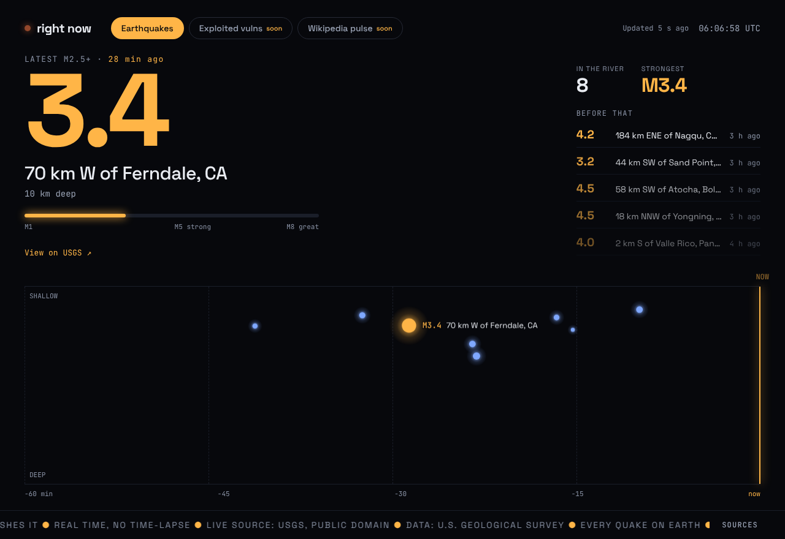
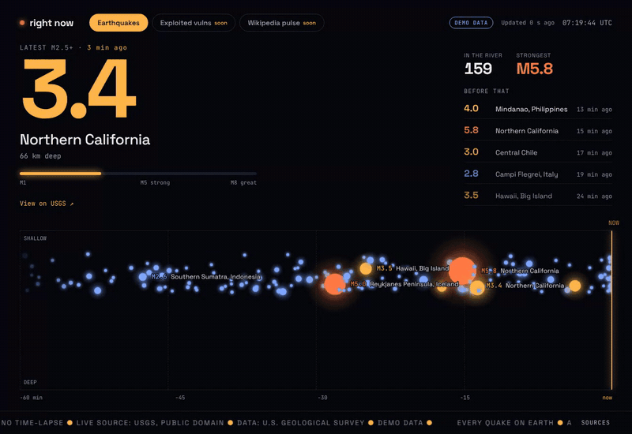

# right now

**A live, beautiful window on what's happening in the world — right now.**

**Live:** https://right-now.rn-earth.workers.dev/earthquakes

Each channel shows one thing happening on Earth in real time, using only open, official, legally reusable data. Every channel uses the same **Flow + Pulse** pattern:

- **Pulse:** the latest important event, shown huge with shockwave rings and a live "4.2 s ago" counter.
- **Flow:** a river of every event. Dots appear at the NOW line and drift left as they age. Size, height and colour encode meaning.
- **Side list:** earlier notable events plus two live stats.
- **Ticker:** the channel's tagline and its data attribution.

| Channel         | Source                                    | Status             |
| --------------- | ----------------------------------------- | ------------------ |
| Earthquakes     | USGS real-time feeds (public domain)      | **v1 — live**      |
| Wikipedia pulse | Wikimedia EventStreams (CC BY-SA content) | **v1.1 — live**    |
| Exploited vulns | CISA KEV + NVD API                        | v1.2 — coming soon |



<sub>Live USGS data, 2026-10-23 06:05 UTC. A real hour is calm.</sub>



<sub>Motion preview recorded with `?demo=1`, which is busier than reality and labelled DEMO DATA. The live site shows only real USGS data.</sub>

## Reading the Earthquakes channel

- **Left → right:** time, from 60 minutes ago to NOW, in real time with no time-lapse.
- **Top → bottom:** depth, from shallow to 700 km, on a square-root scale.
- **Dot size and colour:** magnitude. Blue is below M3, amber is M3–4.9, orange is M5 and above.
- **Important quakes:** every M2.5+ quake gets a ring and a label, and the newest becomes the Pulse. If the last hour was quiet, the Pulse shows the latest M2.5+ from the past day, with an honest "2 h ago".
- **More detail:** hover or tap a dot for details and a link to the USGS event page.

## Reading the Wikipedia pulse

- **Left → right:** the last 60 seconds, at real speed. Every dot is one edit to a Wikipedia article, in any language.
- **Above the line:** text added. **Below the line:** text removed. Distance from the line is the size of the change, on a log scale. Grey dots are bots.
- **The Pulse:** a **surge**, meaning at least 15 edits by at least 5 different people to one article within 10 minutes. That usually means something just happened in the world. Between surges, the Pulse shows the **most-edited article** of the last 10 minutes, labelled as such.
- **Privacy:** usernames and IP addresses are never shown or stored.
- **Bandwidth:** your browser streams about 3 MB per minute from Wikimedia and disconnects while the tab is hidden.

## Run it

Requires Node 22.12 or later (`.nvmrc` pins 22).

```bash
npm install
npm run dev            # http://localhost:5173  (add ?demo=1 for fake data)
npm test               # unit tests (Vitest)
npm run test:e2e       # Playwright smoke tests (fixtures, no network needed)
npm run lint && npm run typecheck
npm run build          # → dist/
```

`?demo=1` turns on dev-only generated data, clearly badged. `?demo=1&dots=1500` stress-tests the river.

## Deploy in 5 minutes (Cloudflare, €0)

1. Create a free Cloudflare account.
2. Go to **Workers & Pages → Create → Import a repository**, pick this repo, and set:
   - **Build command:** `npm run build`
   - **Deploy command:** `npx wrangler deploy`
   - leave everything else at its default

   `wrangler.jsonc` makes the deploy upload `dist/` as static assets, with SPA fallback; `public/_headers` sets the CSP and caching. Static asset requests are free.

3. Production deploys from the default branch (`main`). Other branches get preview URLs.
4. **API Worker** (optional in v1; only a CORS fallback for USGS): `npm run worker:deploy`.
5. **v1.2 only:** `npx wrangler secret put NVD_API_KEY --config worker/wrangler.toml`. The key lives only in Cloudflare; never put it in a file in this repo.

## Architecture

```
src/
  main.ts               boot: header, router, Sources dialog, announcer
  router.ts             /earthquakes · /wikipedia · /exploited
  core/                 channel-agnostic engine
    types.ts            LiveEvent, Channel, PulseConfig
    store.ts            dedupe by id, in-place revisions, window pruning, cap
    river.ts            <canvas> river (DPR-aware, glow sprites, labels, tooltip)
    pulse.ts            hero with A/B swap, shockwave rings, live "ago"
    sidelist.ts         stats + fading list of earlier events
    poller.ts           polling with 2× backoff, paused in hidden tabs
    freshness.ts        "Updated 12 s ago" / "Data delayed" badge
    view.ts             composes a channel screen
  channels/
    registry.ts         the menu (lazy-loaded channels)
    earthquakes/        USGS source, mapping, copy, fixtures, tests
  demo/generators.ts    dev-only fake data (?demo=1)
  styles/               tokens · base · layout · components · animations
worker/                 Cloudflare Worker for /api/* (proxies, future cron)
```

To add a channel, add a folder under `src/channels/` that exports a `Channel`, then add one entry in `registry.ts`.

There is no framework, the CSS is plain, and the river is drawn on a canvas. The first load is about 12 KB of JS and about 4 KB of CSS (gzipped). See [DECISIONS.md](DECISIONS.md) for the choices and measurements.

## Honesty rules

- Production shows only real data; demo data is always badged.
- Every event links to its official source page.
- Times are when the event happened, not when we received it.
- If the source stops answering for more than 3× its poll interval, an amber **"Data delayed — source unreachable"** badge appears. The river keeps drifting, but no fake events are added.
- The tone is calm and factual, with no alarmism.

## Data sources & licenses

See [ATTRIBUTION.md](ATTRIBUTION.md). Earthquake data comes from the **U.S. Geological Survey** (public domain). The fonts (Space Grotesk, JetBrains Mono) are self-hosted under the SIL OFL 1.1.

No cookies and no tracking.
